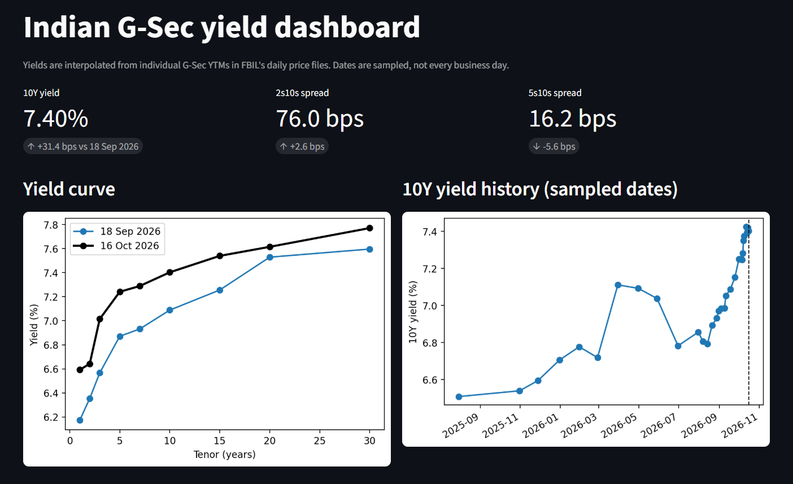
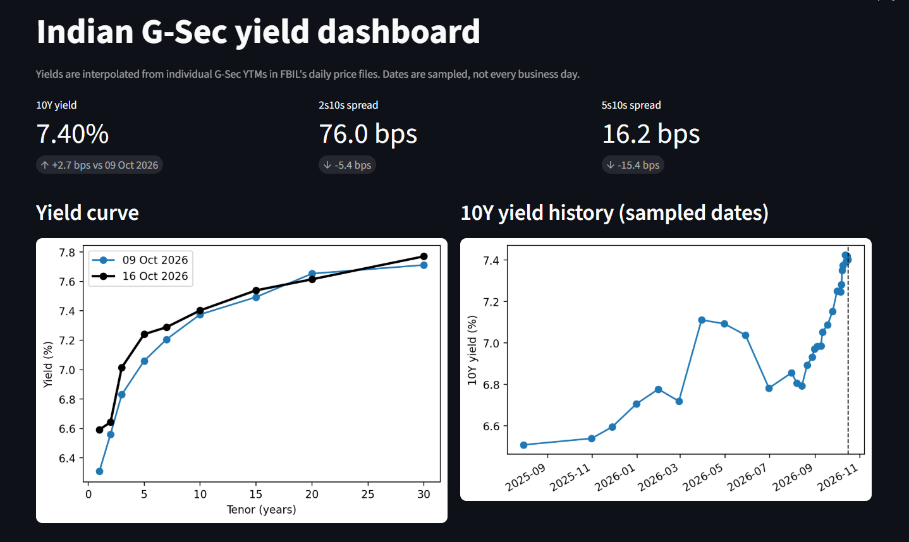

# Indian G-Sec Yield Dashboard

Tracks Indian government bond yields across maturities, compares the yield curve between dates, and labels curve steepening and flattening. Built with Python, pandas and Streamlit.





## What it does
- Builds a yield table (1Y to 30Y) from FBIL's daily G-Sec price files
- Calculates daily, weekly and about-monthly changes in bps
- Calculates curve spreads (2s5s, 2s10s, 5s10s, 10s30s) and labels steepening, flattening and inversion
- Streamlit dashboard with a date picker and a comparison date

## Main findings (16 Oct 2026 vs 18 Sep 2026)
- The 10Y yield is 7.40%, up 31.4 bps
- 2s5s steepened by 8.1 bps. 5s10s flattened by 5.6 bps and 10s30s by 14.0 bps
- 2s10s changed by +2.6 bps, which is borderline and counted as little changed
- No spread was inverted on any sampled date
- See RESEARCH_NOTE.md for possible drivers and sources

## Method
- Fixed-rate G-Secs only. Floating-rate bonds are excluded
- Straight-line interpolation of bond YTMs to fixed tenors
- Label threshold: the median absolute one-day move of each spread over the last 10 business days

## Data
Source: FBIL (www.fbil.org.in), daily G-Sec price files, downloaded by hand. FBIL does not authorise commercial use without written permission, so the raw files are not in this repository. To reproduce, download the files from FBIL into a folder called `data`. See DATA_SOURCES.md.

## Limitations
- Dates are sampled (daily for 10 days, weekly, then roughly monthly), not every business day
- Interpolated yields differ from the yield on a single benchmark bond
- The 1Y point is noisy and is not used in the spread labels
- The label threshold comes from only 10 days of data
- The meaning of FBIL remarks such as "Input Point" and "YC" has not been verified

## Run it
```
pip install -r requirements.txt
python -m streamlit run app.py
```

## Tests
```
python -m pytest -v
```
